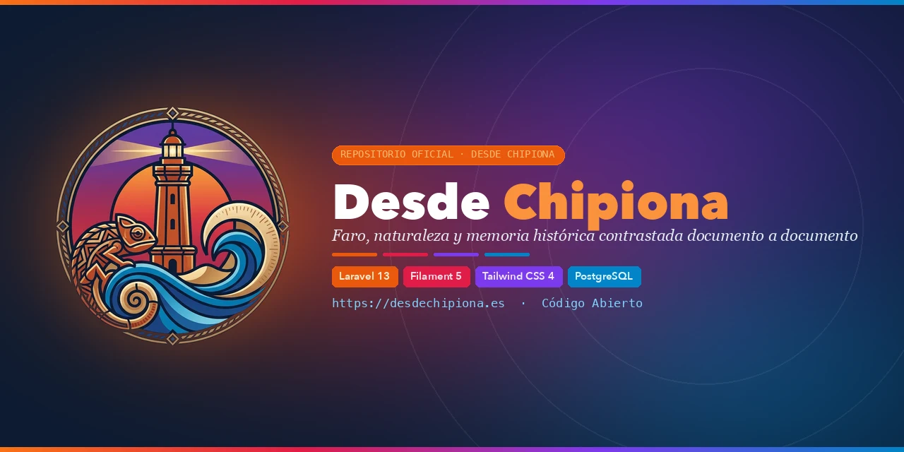

<div align="center">



# Desde Chipiona

**Faro, naturaleza y memoria histórica contrastada documento a documento**

[](https://desdechipiona.es)
[](https://t.me/desdechipiona)
[](https://gitlab.com/raupulus/www.desdechipiona.es)
[](https://github.com/raupulus/www.desdechipiona.es)

### 🌐 [https://desdechipiona.es](https://desdechipiona.es)

---

</div>

*Última actualización: 2026-11-04*

## 📖 Sobre el Proyecto

**Desde Chipiona** es una plataforma digital abierta y rigurosa dedicada a la investigación, verificación y divulgación de la historia, el patrimonio marítimo y la naturaleza de Chipiona (Cádiz).

Fundado originalmente en **2008** como portal pionero sobre la localidad y renovado íntegramente desde cero en **2026**, el proyecto abarca desde la prehistoria y la Antigüedad romana (*Caepionis Turris*, alfares de salazón y pecios) hasta los siglos XIX, XX y la actualidad (el Faro de Jaime Font, el Sanatorio marítimo de Santa Clara, los corrales de pesca y la memoria comunitaria). Cada artículo y afirmación se apoya en fondos documentales de archivo (PARES, AHN, AGS, AHPC y archivos municipales) y fuentes oficiales contrastadas, separando con total transparencia los hechos documentados de la tradición oral y las hipótesis académicas.

---

## 🎨 Sistema de Identidad y Paleta Cromática

El portal articula su diseño en **Tailwind CSS v4** mediante una paleta de 4 ejes identitarios inspirados en la historia de la villa:

| Eje Cromático | Tono Tailwind | Hex | Simbolismo Histórico y Rol en la Web |
|---------------|---------------|-----|--------------------------------------|
| **Naranja Terracota** | `orange-600` | `#ea580c` | Alfar romano de El Olivar, *Caepionis Turris*, llamadas a la acción (CTA) y Antigüedad |
| **Rojo Lacre** | `rose-600` | `#e11d48` | Carta Puebla de 1477, sellos nobiliarios de la Casa de Arcos y alertas de discrepancia |
| **Morado Archivo** | `violet-600` | `#7c3aed` | Siglos XIX–XXI, citas literales, fuentes documentales `[F-XXXX]` y glosario |
| **Azul Atlántico** | `sky-600` / `blue-900` | `#0284c7` | El océano Atlántico, el Faro, los corrales de pesca y navegación estructural |

Consulte la especificación completa en [docs/info/DESIGN.md](docs/info/DESIGN.md) y el kit de copys y redes en [datos-redes.md](datos-redes.md).

---

## 🚀 Stack Tecnológico

| Tecnología | Versión | Propósito en el Proyecto |
|------------|---------|--------------------------|
| **PHP** | 8.5 | Backend tipado estricto con backed enums y readonly properties |
| **Laravel** | 13.x | Framework de aplicaciones web |
| **PostgreSQL** | 16.x | **Motor de base de datos obligatorio** (`DB_CONNECTION=pgsql`) |
| **Filament** | 5.x | Panel de administración (`/admin`) y panel de usuario (`/panel`) |
| **Tailwind CSS** | 4.x | Framework CSS utilitario configurado vía `@theme` nativo |
| **Alpine.js** | 3.x | Interactividad reactiva ligera y modales |
| **Vite + pnpm** | 8.x / 10.x | Bundler de assets y gestor de paquetes frontend |
| **Laravel Sanctum** | 4.x | Autenticación y tokens de API REST |
| **spatie/laravel-translatable** | 6.x | Soporte multilingüe en modelos Eloquent |
| **spatie/laravel-sitemap** | 8.x | Generación automatizada de sitemaps XML |
| **knuckleswtf/scribe** | 5.x | Documentación interactiva de la API en `/docs` |

---

## 🛠️ Instalación en Desarrollo Local

### Requisitos Previos:
- **PHP 8.5** con extensiones `pdo_pgsql`, `pgsql`, `mbstring`, `curl`, `gd`, `intl`, `zip`.
- **PostgreSQL 16** activo en local o mediante Docker.
- **Composer 2.7+**, **Node.js 20+** y **pnpm 10+**.

### Pasos de Instalación:

```bash
# 1. Clonar el repositorio
git clone https://gitlab.com/raupulus/www.desdechipiona.es.git
cd www.desdechipiona.es

# 2. Configurar el archivo de entorno
cp .env.example .env

# 3. Configurar en .env la conexión a PostgreSQL:
# DB_CONNECTION=pgsql
# DB_HOST=127.0.0.1
# DB_PORT=5432
# DB_DATABASE=desdechipiona_db
# DB_USERNAME=postgres
# DB_PASSWORD=tu_password

# 4. Instalación guiada de dependencias, base de datos y clave
php artisan project:install

# 5. Cargar datos corporativos y de muestra
php artisan project:dummy

# 6. Iniciar el entorno de desarrollo concurrente
composer run dev
```

---

## 🐳 Despliegue con Docker

El proyecto incluye configuración Docker lista para desarrollo:

```bash
cp .env.example .env
docker compose up -d
docker compose exec app php artisan project:install --force
docker compose exec app php artisan project:dummy
```

- **Aplicación web**: [http://localhost:8000](http://localhost:8000)
- **Panel Admin**: [http://localhost:8000/admin](http://localhost:8000/admin)

---

## 🧪 Calidad de Código y Tests

```bash
# Formatear el código con Laravel Pint (PSR-12)
composer run pint

# Comprobación de formato sin modificar
composer run pint:test

# Suite completa de verificación (formato + tests automatizados compactos)
composer run check
```

---

## 📚 Documentación Técnica Viva (`docs/info/`)

La documentación de la plataforma se mantiene actualizada bajo `docs/info/`:

- **[Índice General de Módulos](docs/info/README.md)**: Modelos, relaciones, controladores y servicios.
- **[Guía de Diseño y Estilos](docs/info/DESIGN.md)**: Tokens Tailwind CSS v4, layout y paleta cromática.
- **[Kit de Redes Sociales y Copys](docs/info/datos-redes.md)**: Textos oficiales, banners y etiquetas para difusión.
- **[Catálogo de Componentes UI](docs/info/COMPONENTS.md)**: Componentes Blade normalizados.
- **[Comandos Artisan](docs/info/commands.md)**: Especificación de comandos `project:install`, `project:clear`, etc.

---

## 📡 Canales y Enlaces Oficiales

- 🌐 **Sitio Web Oficial**: [https://desdechipiona.es](https://desdechipiona.es)
- ✈️ **Canal de Telegram**: [https://t.me/desdechipiona](https://t.me/desdechipiona)
- 🦊 **GitLab (Fetch & Push)**: [gitlab.com/raupulus/www.desdechipiona.es](https://gitlab.com/raupulus/www.desdechipiona.es)
- 🐙 **GitHub (Backup Push)**: [github.com/raupulus/www.desdechipiona.es](https://github.com/raupulus/www.desdechipiona.es)

---

## 👤 Autor

**Raúl Caro Pastorino** (`@raupulus`)

Desarrollador Full Stack Senior especializado en arquitectura Backend (PHP / Laravel, Python), PostgreSQL, Inteligencia Artificial aplicada en producción, administración de sistemas GNU/Linux y proyectos Open Source / IoT.

- 🌐 **Web**: [https://raupulus.dev](https://raupulus.dev)
- 📄 **CV Online**: [https://curriculum.raupulus.dev](https://curriculum.raupulus.dev)
- ✉️ **Contacto**: [public@raupulus.dev](mailto:public@raupulus.dev)

---

## 📄 Licencia

Este proyecto está bajo la licencia [MIT](LICENSE).
